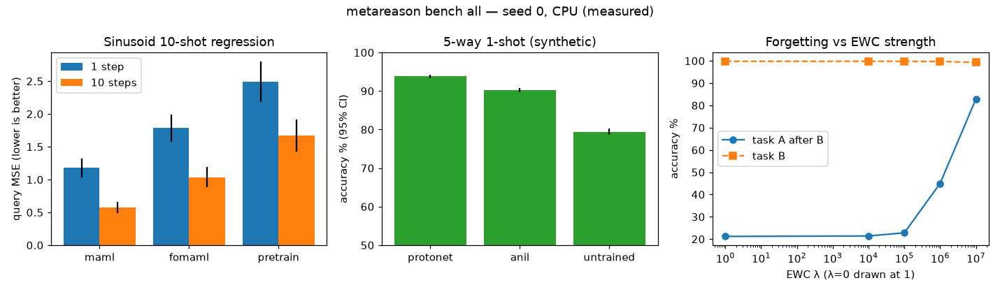
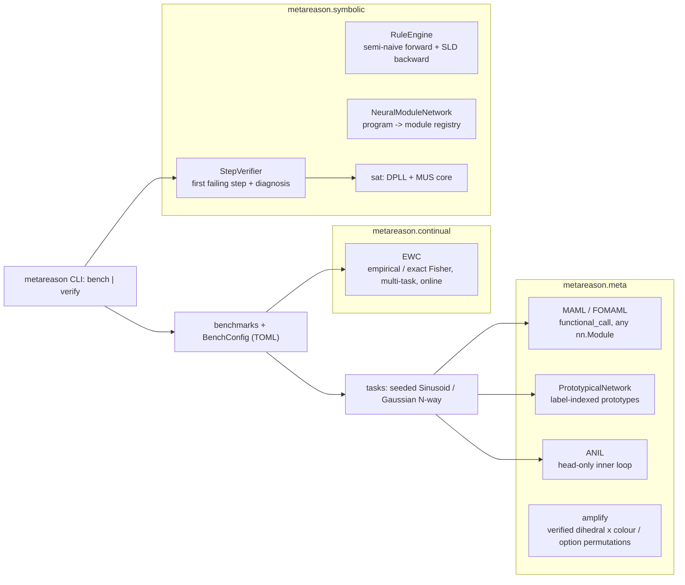

# MetaReason-Torch: meta-learning with verifiable neurosymbolic reasoning in PyTorch

[](https://github.com/Cyb0rg137ms/MetaReason-Torch-Modular-Meta-Learning-Neuro-Symbolic-Library/actions/workflows/ci.yml)

[](LICENSE)

MAML, FOMAML, ProtoNets, ANIL and EWC behind one typed PyTorch API, plus a step verifier that reports the first inconsistent reasoning step and a minimal conflict.



*Figure: rendered by `python scripts/plot_bench.py` from [`docs/assets/bench.json`](docs/assets/bench.json), the raw output of `metareason bench all --config examples/bench.toml --json` (seed 0, CPU).*

## Why it matters

Meta-learning and neurosymbolic reasoning are usually studied in separate codebases. This library puts gradient-based meta-learning (MAML, FOMAML, ProtoNets, ANIL), continual learning (EWC) and *checkable* symbolic reasoning behind one typed PyTorch API. Each reasoning step can be compiled to CNF and decided exactly, so a failure comes with the first failing step and a minimal conflict instead of a vague score. Every method is tested against a hand-computed or brute-force reference (74 tests plus the plot test).

## Key results

These are the results of `metareason bench all` with seed 0 and the defaults in `examples/bench.toml`. The run was on a CPU-only Intel Xeon VM with PyTorch 2.14.1 and took 32 s wall-clock. Confidence intervals are Student-t 95%.

**Sinusoid regression** (10-shot, 2000 meta-iterations, meta-batch 8, 300 held-out tasks; MSE on query points after adaptation):

| method | MSE after 1 step | MSE after 10 steps | ms / meta-iter |
|---|---|---|---|
| MAML (2nd order) | **1.180 ± 0.143** | **0.576 ± 0.084** | 5.3 |
| FOMAML | 1.783 ± 0.206 | 1.037 ± 0.158 | 3.7 |
| Joint pre-training + fine-tune | 2.489 ± 0.307 | 1.674 ± 0.247 | 1.3 |

**Few-shot classification** (synthetic 5-way 1-shot Gaussian classes, 16-d, 1000 training episodes, 600 test episodes):

| method | accuracy % | ms / episode |
|---|---|---|
| ProtoNet | **93.80 ± 0.43** | 1.0 |
| ANIL (5 head steps) | 90.29 ± 0.57 | 1.8 |
| Untrained embedder + nearest prototype | 79.41 ± 0.80 | — |

**Catastrophic forgetting with EWC** (exact Fisher; two 5-way tasks trained one after the other with the same output head; accuracy on task A):

| λ | A before B | A after B | B |
|---|---|---|---|
| 0 | 99.8 | 21.2 | 99.8 |
| 1e5 | 99.8 | 22.8 | 99.8 |
| 1e6 | 99.8 | 45.0 | 99.7 |
| 1e7 | 99.8 | **82.9** | 99.3 |

The ordering MAML > FOMAML > pre-training and ProtoNet > ANIL matches the literature qualitatively. These are synthetic tasks, so they are not comparable to Omniglot or miniImageNet numbers.

Reproduce:

```bash
pip install torch --index-url https://download.pytorch.org/whl/cpu && pip install -e ".[dev]"
metareason bench all --config examples/bench.toml --json   # about 30 s on CPU
python scripts/plot_bench.py docs/assets/bench.json docs/assets/bench.png
```

## Architecture



More diagrams: [docs/ARCHITECTURE.md](docs/ARCHITECTURE.md).

## 60-second quickstart

```bash
pip install torch --index-url https://download.pytorch.org/whl/cpu   # or your CUDA/ROCm build
pip install -e ".[dev]"
metareason bench all --quick
metareason verify examples/trace.json          # exit 1 + diagnosis on an inconsistent trace
```

## Usage

```python
import torch
from torch import nn
from metareason import MAML, StepVerifier
from metareason.tasks import SinusoidTasks

model = nn.Sequential(nn.Linear(1, 40), nn.ReLU(), nn.Linear(40, 1))
maml = MAML(model, inner_lr=0.01, inner_steps=1)  # first_order=True -> FOMAML
opt = torch.optim.Adam(model.parameters(), 1e-3)
for _ in range(100):
    maml.meta_step(SinusoidTasks().batch(8), opt)

v = StepVerifier([[1, 2], [-1, 3], [-3, -2]])  # CNF problem
r = v.verify(["Assume x2 = true.", "Then x3 = false.", "Also x1 = true."])
print(r.diagnosis.explain())
# step 3 is inconsistent with step(s) 2 and problem constraint(s) [2];
# minimal conflict [[-1, 3], [-3], [1]]; restart from step 2.
```

More examples are in [`examples/`](examples); a multi-task experiment is in `experiments/multi_task.py`.

Development:

```bash
ruff check . && ruff format --check . && mypy metareason && pytest
```
There are 74 tests. They cover:
- MAML against hand-computed SGD and finite-difference second-order gradients
- SAT against brute force on 300 random formulas, and minimality of the unsat core
- forward and backward chaining agreement on random programs
- the amplification inverse round-trip
- the CLI

## Design decisions and trade-offs

- **Functional MAML (`torch.func.functional_call`)** works for any `nn.Module` and supports exact second-order gradients. The cost is roughly 1.4x FOMAML per meta-iteration in the table above; `first_order=True` trades that for higher error.
- **Exact DPLL plus a minimal unsatisfiable core** in the step verifier. Diagnoses are exact and minimal, at the cost of scaling only to the small CNFs typical of reasoning traces.
- **Amplification keeps a variant only if inverting the transform recovers the gold answer exactly**, which trades dataset size for zero label noise.
- **SLD backward chaining with loop checking** instead of tabling: simple and correct on recursive programs, but potentially exponential; `forward_chain` is the materialising alternative.
- **Synthetic, seeded benchmarks** so every number is reproducible in about 30 s on a CPU; they are not comparable to Omniglot or miniImageNet.

Changes relative to 1.0:

- **ANIL:** the feature extractor ran under `torch.no_grad()`, so the outer loop never trained it.
- **Rule engine:** backward chaining could not prove recursive goals unless `forward_chain()` had already run, because body variables were only bound against materialised facts. Rule variables were also never renamed apart. The engine is now SLD resolution with loop checking.
- **ProtoNet:**
  - The loss assumed queries were sorted by class.
  - Prototypes assumed balanced, sortable support sets.
  - Labels are now explicit; the old call style still works with a deprecation warning.
- **EWC:**
  - The penalty was a Python `float` before any task was registered.
  - The model was left in `eval()` mode.
  - Shape handling made `MSELoss` broadcast silently.
- **Confidence intervals:** they used a wrong t-value (2.045 for every n < 30).
- **NMN:** string leaves were indexed character by character.
- **MAML:**
  - It was limited to one hard-coded MLP and a single inner step, with no outer loop.
  - It now has a generic functional implementation with k steps, a first-order mode and `meta_step`.
- **Removed:** fabricated `BENCHMARK_RESULTS.md`, such as the Omniglot numbers that were never measured.

The step verifier and amplification modules are clean re-implementations of ideas from the author's research prototypes (CNF-gated step verification with retry; verified dihedral/colour augmentation of ARC tasks). Method references: Finn et al. 2017 (MAML), Snell et al. 2017 (ProtoNets), Raghu et al. 2020 (ANIL), Kirkpatrick et al. 2017 (EWC), Schwarz et al. 2018 (online EWC), Andreas et al. 2016 (NMN).

## Limitations and roadmap

- Benchmarks are synthetic; no Omniglot/miniImageNet results are reported.
- EWC needed λ of 1e6–1e7 on this saturated two-task benchmark.
- The step verifier checks consistency, not correctness, and parses steps with regexes.
- DPLL only; use a CDCL solver for large CNFs.
- CPU-only CI; GPU paths are standard PyTorch but untested.

Roadmap: a CDCL backend option, tabled backward chaining, and real few-shot datasets (Omniglot) with reported numbers once measured.

Full list: [docs/LIMITATIONS.md](docs/LIMITATIONS.md).

## Citation

```bibtex
@software{metareason2026,
  author = {Cyb0rg137ms},
  title  = {MetaReason-Torch: meta-learning with verifiable neurosymbolic reasoning in PyTorch},
  year   = {2026},
  url    = {https://github.com/Cyb0rg137ms/MetaReason-Torch-Modular-Meta-Learning-Neuro-Symbolic-Library}
}
```

## License

MIT, see [LICENSE](LICENSE).
