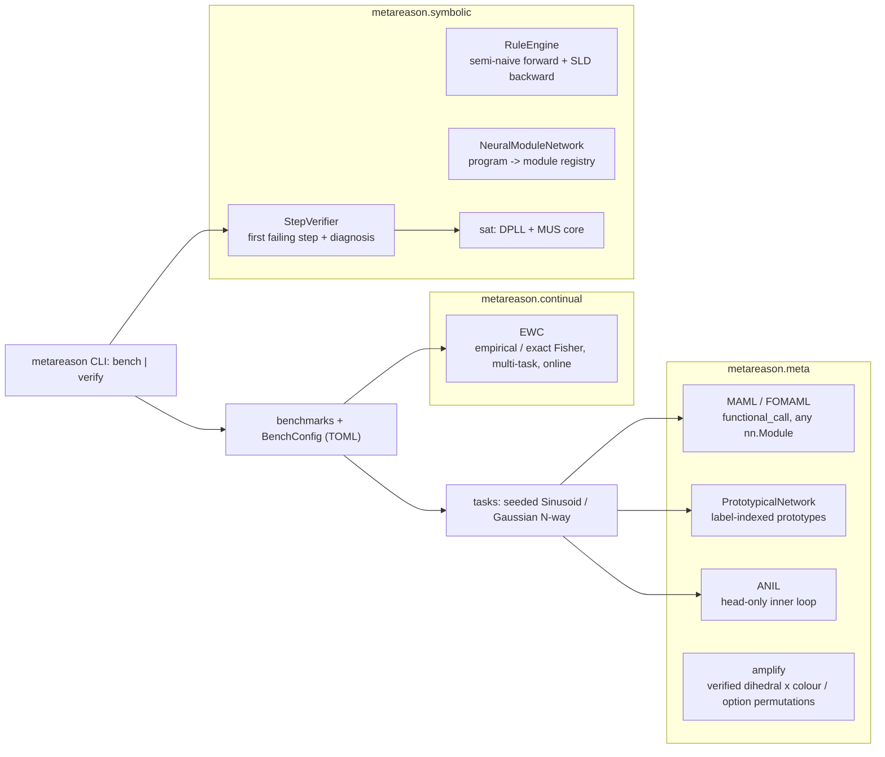
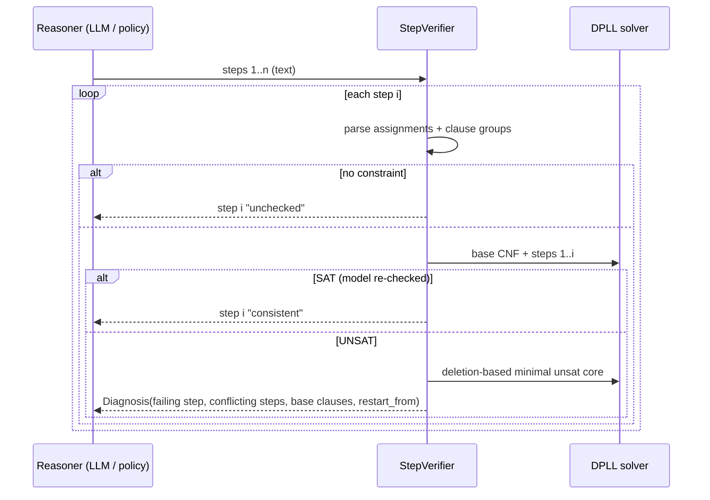

# Architecture

## Step verification flow

## Design choices

* **Functional inner loops.** MAML never mutates the model; adapted parameters are dicts fed to `torch.func.functional_call`, so any architecture, including ones with buffers, works, and evaluation can call `adapt` inside `torch.no_grad()`.
* **Exactness over speed in the symbolic layer.** The SAT solver is complete and every model is re-checked, and the unsat core is provably minimal (each clause is necessary). Traces are small, so the quadratic MUS search is cheap.
* **Verified augmentation.** A variant is kept only if inverting the transform reproduces the original gold answer. This guards against label-corrupting augmentations.
* **Back-compat.** The 1.0 public API (`MetaModel`, `MAML.adapt_to_task`, `compute_prototypes(z, n_way=, k_shot=)`, `fisher_matrix`, `optimal_weights`) still works. The 1.0 tests are kept and pass.
